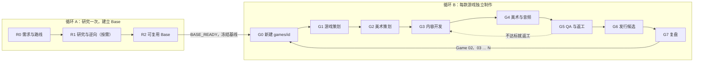

# Game Production Skills

**研究一次成熟游戏机制，建立可复用 Base，之后通过独立的游戏策划、美术规划和制作循环，连续生产不同的游戏。**

这个仓库包含多个相互独立、可以单独安装的 Skill，都不绑定特定的 Agent、模型、引擎或设备：

| Skill | 位置 | 版本 | 用途 |
|---|---|---|---|
| **game-reverse-engineering** | [`skills/game-reverse-engineering/`](skills/game-reverse-engineering/) | 1.1.0（新增） | 研究参考游戏，交付经过能力等价验证的 2D **Creator Ready Base** |
| **game-production** | 仓库根目录（本页下半部分） | 4.1.0（稳定） | 工作区、版本化 Base、`games/<id>/` 多游戏全流程与门禁 |
| game-creation-polish | 规划中 | — | 基于 Base 制作游戏与打磨（后续建设） |

两个 Skill 共用同一种项目记录格式：先用 game-reverse-engineering 建 Base，再用 game-production 基于它做游戏。已有的 game-production 项目和入口继续有效。

## 🔬 逆向与 Base：最快开始（game-reverse-engineering）

在新设备、新 Agent、空文件夹中，只需要提供**目标游戏链接、Skill 链接和交付目标**。替换【】中的内容后整段发送：

```text
请使用 Game Reverse Engineering Skill，研究下面的参考游戏，并交付一个可复用的 2D 游戏 Base。

参考游戏（链接、开源仓库或本地工程路径）：
【粘贴链接或路径】

Skill 仓库：
https://github.com/Chalmo8888/game-production
（使用仓库中的 skills/game-reverse-engineering 目录；根目录的 game-production 是另一个 Skill）

研究与 Base 交付目标：
【例如：研究这款横版射击游戏，交付 Creator Ready 的 H5 Base：保留或提升原版的手感、敌人与 Boss、
武器、关卡事件、拆件动画、特效、UI 和资源管线，并用两套原创测试配置证明可以换角色、动画、单位、
地图和视觉风格。不需要正式游戏和商业级美术。】

获取并加载 Skill：如果当前项目已有 .agents/skills/game-reverse-engineering/，以它为准；否则把上面的
仓库克隆或下载到项目之外的临时目录，阅读 skills/game-reverse-engineering/SKILL.md，然后运行
python <临时目录>/skills/game-reverse-engineering/scripts/gre.py init --project <当前目录>
--code-path <Base 代码目录> --core-path <引擎核心目录> --reference <参考链接> --basis "<我的原话>"
它会把 Skill 固定安装到当前项目，并创建与 game-production v4 兼容的记录，不覆盖已有文件。
已有工程或 v4 项目按 prompts/TAKEOVER.md 接管；之后每次开始先运行 gre.py resume。

按 SKILL.md 的 E0–E7 推进，由你一个 Agent 完成全部工作，不需要等待其他 Agent：
E0 技术调查（包括能否动态运行原作），当天就建立 Base 骨架 → E1 授权与复用判断（REUSE.json、RE01）
→ E2 源码与动态行为研究 → E3 在能力等价矩阵中覆盖全部 15 个能力域（不只是玩法，还包括动画、
渲染、特效、UI、资源管线和音频），并从原版代码、运行行为和资源结构中发现模板之外的游戏特有能力
→ E4 逻辑系统 → E5 2D 表现系统 → E6 Creator 生产能力测试：两套视觉明显不同的原创配置运行在同一个
稳定核心上，各自通过配置做出有实际意义的玩法改动，并以正常输入跑通短小完整的循环 → E7 报告、
交接和冻结 Base 版本。

能合法复用的成熟代码和系统优先直接复用；不能合法复用的才独立实现；已有能力不足的要优化。
原作细节难以恢复时，评估改用授权明确的成熟组件，不无限研究低收益细节。
不要求照搬原版源码，也不要做低配模拟品。没有使用权利的反编译代码和原作资源只放在被忽略的
research-private/ 中研究，不进入 Base。研究必须服务于矩阵中的缺口，并设时间盒。
只有带测试、运行时录制或测量证据、并绑定当前代码的 VERIFIED 才算完成，只有接口或文档的不算。
如实标注能力来源：PARITY（有原版证据）/ REPLACEMENT（不同的合规实现）/ EXTENSION（原创扩展）；
原版行为不明确时不得宣称 PARITY。每轮用 gre.py next 选择价值最高的缺口，不在高优先级缺口未完成时
连续打磨。Logic Ready ≠ Presentation Ready ≠ Creator Ready；第三方代码许可、原作素材与具体表达的
使用权、用户公开发布批准分别记录，技术测试不能使其通过，也不宣称零版权风险。

【无人值守执行规则】
开始调查并执行，直到达到当前授权范围内可验证的交付目标，或遇到无法自行解决的真实外部阻断。
只要执行环境允许、授权与预算范围内仍有有价值且可执行的工作，就继续研究、设计、实现、测试、
检查、返工和扩展。不要因为完成一个小版本、研究文档或演示程序就主动停止。优先解决对 Base 能力
和可复用性影响最大的缺口。如果工具挂起，及时检测并恢复。如果某项工作受阻，记录原因并继续其他
可执行任务。同一方案连续失败，应重新调查根因，不无意义重试。测试结果必须保留历史证据，不得直接
覆盖重要记录。不要通过空转、重复小修和无效提交制造工作时长。执行环境中断时，保存精确状态与
恢复入口，不假装仍在后台运行。

本次只交付研究和 Base，不制作游戏。在稳定检查点创建本地 Git commit。未经明确授权，不 push、
不公开部署、不付费、不上传研究原件或原作资源、不删除无关文件。

最终报告：Base 位置与版本、证据支持的交付等级、能力等价矩阵报告路径、游戏特有能力、
PARITY/REPLACEMENT/EXTENSION 统计、主要差异与静态证据项、复用与隔离情况、两套测试配置、
权利状态、未完成项和下一步。现在开始实际工作，不要只回复计划。
```

**交付等级**：Logic Ready（L1–L6 玩法、控制、AI、武器、关卡、存档 UI 全部验证）→ Presentation Ready（P1–P8 图集、逐帧/拆件/骨骼动画、状态与事件、分层渲染、特效阴影、资源管线、音画同步、性能全部有运行时或测量证据）→ Creator Ready（Base 的生产能力测试：两套视觉明显不同的原创配置运行在同一个稳定核心上，可以共用公共字体和基础资源；各自通过配置或扩展接口做出有实际意义的玩法改动，并以正常输入跑通短小完整的游戏循环。只换图片不算）。能力来源分为 PARITY / REPLACEMENT / EXTENSION，模板之外的游戏特有能力要主动发现。第三方代码许可、原作素材与具体表达的使用权、用户发布批准分别记录，技术测试不能使其通过。

**其他入口**：[接管已有工程或 v4 Base](skills/game-reverse-engineering/prompts/TAKEOVER.md) · [跨会话/设备/Agent 接续](skills/game-reverse-engineering/prompts/RESUME.md) · [能力等价矩阵规则](skills/game-reverse-engineering/references/CAPABILITY_PARITY.md) · [三个实际项目的经验](skills/game-reverse-engineering/references/LESSONS.md)

---

# game-production v4

适用于独立开发者和团队。不绑定 Cursor、Codex 或任何模型、引擎、平台、设备：同一个 Agent 可以完成全程，也可以让多个 Agent 跨会话、跨设备接力。

> **核心原则：结果优先，证据验收，无人值守推进，范围不擅自扩大。** 完成一个阶段不等于完成任务；Base 通过不等于游戏合格；游戏合格不等于获准公开发布。本 Skill 不能保证 Agent 永久在线，也不能自动证明作品可以商用。
>
> 只需要深度研究并建设 Base 时，优先使用上面的 game-reverse-engineering；下面的「研究原游戏」提示词仍然有效，适合把研究与后续制游戏放在同一个工作流中。

## 🗺️ 工作流



- **循环 A** 只做一次：调查原游戏 → 提取机制 → 审查来源与许可 → 合法复用或独立实现 → 得到带版本的 Base（核心玩法、配置接口、资源动画接口、构建测试、示例内容）。
- **循环 B** 每款游戏做一遍：在 `games/<id>/` 下有独立的策划、美术方向、配置、单位、关卡、资产、测试记录、构建产物和发布状态，**引用** Base 的某个版本，而不是复制整个引擎。
- 已完成且仍然有效的研究不重复做。新游戏需要 Base 没有的机制时，才按需补充研究；通用改动会升 Base 版本，并对已完成的游戏做回归。

## 🎯 适用场景

| 你手上有 | 你想要 | 使用 |
|---|---|---|
| 一个参考游戏的链接 / 开源项目 / 源码 | 先研究，建立以后能反复用的 Base | 下方「研究原游戏」提示词 |
| 已经建好的 Base | 做一款新题材的游戏 | 下方「基于 Base 新建游戏」提示词 |
| 参考游戏 + 第一款游戏的想法 | 一次性做完研究、Base 和第一款游戏 | 下方「一次性完整生产」提示词 |
| 已有 Base + 一份游戏清单 | 连续做 N 款 | [`prompts/BATCH_PRODUCTION.md`](prompts/BATCH_PRODUCTION.md) |
| 做到一半的游戏或 v3 项目 | 接着做完 | [`prompts/ADOPT_EXISTING.md`](prompts/ADOPT_EXISTING.md) / [`prompts/CONTINUE_GAME.md`](prompts/CONTINUE_GAME.md) |

## 🚀 最快开始

1. 打开任何能访问 GitHub、读写文件并执行命令的 Agent（Cursor、Codex 或其他）。
2. 选择下面三段提示词中的一段，**替换【】中的内容**，整段发送。
3. Agent 会自己安装或加载 Skill，初始化项目记录，然后在你授权的范围内持续工作。你不需要先学习所有规则。

已有 Base 时最短的说法：**“基于这个 Base 开始制作第二款游戏，主题为 XXX，按 START_NEW_GAME 执行。”**

### ① 研究原游戏并建立 Base

```text
请按照 Game Production Skill，研究下面的参考游戏，并建立一个可复用的游戏 Base。

参考游戏/项目（链接、开源仓库或本地工程路径）：
【粘贴链接或描述】

Game Production Skill：
https://github.com/Chalmo8888/game-production

Base 的目标与范围：
【例如：提取塔防核心机制，建立可以通过配置新增单位/关卡/资产的 H5 Base，后续用来做多款不同题材的游戏】

请先阅读 Skill 仓库的 README.md、SKILL.md 和 prompts/START_RESEARCH.md。若当前项目已有
.agents/skills/game-production/，以项目内的固定版本为准。确认当前目录和已有工程后，用
scripts/project.py init --target base --reference <参考链接> 初始化工作区（不覆盖已有文件；
v3 项目改用 migrate）。用户原话写入授权范围的 basis。

本次授权范围是 base：完成 R0 → R1 → R2，达到 BASE_READY 即可交付并停止。
未经我明确要求，不要创建游戏子项目。

R0：确认最终目标、目标平台、授权边界、已有工程和可用工具。
R1：按需研究源码结构、机制与状态机、数值与配置、单位/敌人行为、关卡结构、动画与资源管线、
原版运行行为、技术依赖和商业授权边界。机制矩阵中保留 VERIFIED / STATIC_ONLY / INFERRED /
PROXY / UNKNOWN 的区分。没有使用权利的反编译代码，不能改写后当作可商用代码；隔离研究，
只提炼通用机制。
R2：有合法依据的现成实现优先复用和适配，不默认重写引擎。建立核心玩法、数据配置接口、
资源与动画接口、关卡/内容扩展接口、构建与测试、示例内容和版本记录。用 base register 登记，
B01–B08 逐项取得证据，并区分 RESEARCH_READY / BASE_READY / COMMERCIAL_BASE_CANDIDATE。
达到 BASE_READY 后冻结基线（base update --freeze），在 CAPABILITIES.md 中写清扩展点、
资产接口和已知限制。BASE_READY 不意味着原版已全部逆向，也不意味着某款游戏已经完成。

【无人值守执行规则】
开始调查并执行，直到达到当前目标可验证的交付要求，或遇到无法自行解决的真实外部阻断。
只要执行环境允许，在授权和预算范围内仍有有价值且可执行的工作，就继续研究、开发、测试、
检查、返工和扩展。普通技术决策自行处理，不需要我进行阶段审批。完成一个小功能、一个里程碑
或一个版本，不构成自动停止条件。发现质量不达标，必须自主定位问题并返工。一个任务受阻，
应继续其他不依赖该任务的工作。不允许通过空循环、重复无意义操作或虚假汇报制造工作时长。
会话或执行环境终止时保存真实检查点，不声称仍在后台执行。
无人值守意味着自主完成已授权目标，不意味着无限扩大目标。

记录状态到 .production/，在稳定检查点创建本地 Git commit。未经明确授权，不 push、不公开部署、
不购买付费服务、不上传未授权素材、不删除无关文件、不修改无关项目或生产环境。

最终报告：Base 位置与版本、就绪度及证据、核心能力与扩展点、来源审查结论、未通过事项，
以及下一步如何用 START_NEW_GAME 基于它制作第一款游戏。现在开始实际工作，不要只回复计划。
```

### ② 基于现有 Base 新建一款游戏

在已有工作区中打开 Agent：

```text
请按照当前项目中的 Game Production Skill，基于现有 Base 开始制作一款新游戏。

新游戏主题与目标：
【例如：主题为深海探索的塔防，单位和关卡与之前的游戏明显不同，完成可游玩的本地发行候选包】

使用的 Base：【留空表示当前焦点 Base 的最新冻结版本；或写 core@1.2.0】

请读取 .agents/skills/game-production/SKILL.md（不能自动发现时显式读取；项目中没有 Skill 时
先阅读 https://github.com/Chalmo8888/game-production 的 README.md 和 SKILL.md），以及
.production/WORKSPACE.json、.production/HANDOFF.md、Base 的 CAPABILITIES.md，和已有游戏的
retrospective。

1. 用 project.py status 检查现有的 Base、版本、就绪度和游戏列表。
2. 用 project.py game create --id <新 slug> --base <base@version> --user-request "<我的原话>"
   在 games/<slug>/ 下创建独立的游戏，记录 Core 依赖，不复制引擎。
3. 从 G1 游戏策划开始：GAME_DESIGN.md 17 节，写清楚这款游戏与研究对象、与同一 Base 上
   其他游戏的区别，哪些来自 Base、哪些是本游戏扩展、哪些需要反哺 Base，并转化成配置需求、
   行为规格和开发任务。
4. G2 美术策划：先读取 Base 的真实资产接口，再写 ART_DIRECTION / ART_ASSET_PLAN /
   ANIMATION_SPEC，并用一个代表资产完成全链路验证后再批量制作。
5. G3 开发 → G4 美术音频 → G5 完整 QA 与返工 → G6 独立打包 → G7 复盘。

不要重复已经完成且仍然有效的原版逆向。只有新游戏需要超出 Base 能力的机制时，才按需补充研究
和扩展；改 Base 要升版本，并对其他依赖游戏做回归，不能破坏已经完成的游戏。只写本游戏的目录，
不要把其他游戏的资产、数值或 QA 状态写进来。

【无人值守执行规则】
开始调查并执行，直到达到当前目标可验证的交付要求，或遇到无法自行解决的真实外部阻断。
只要执行环境允许，在授权和预算范围内仍有有价值且可执行的工作，就继续研究、开发、测试、
检查、返工和扩展。普通技术决策自行处理，不需要我进行阶段审批。完成一个小功能、一个里程碑
或一个版本，不构成自动停止条件。发现质量不达标，必须自主定位问题并返工。一个任务受阻，
应继续其他不依赖该任务的工作。不允许通过空循环、重复无意义操作或虚假汇报制造工作时长。
会话或执行环境终止时保存真实检查点，不声称仍在后台执行。
无人值守意味着自主完成已授权目标，不意味着无限扩大目标：完成这款游戏后停止，不要自动开始下一款。

测试通过不等于游戏品质通过；所有结论绑定版本和证据，未知记为未验证，不得自我放行。
在稳定检查点创建本地 Git commit。未经明确授权，不 push、不公开部署、不付费、不上传未授权素材、
不删除无关文件。

最终报告：游戏目录、绑定的 Base 版本、就绪度与证据、运行和打包方式、未通过事项。
现在开始实际工作。
```

### ③ 一次性完整生产：研究 → Base → 第一款游戏

```text
我希望你按照 Game Production Skill，一次性完成研究、可复用 Base 和第一款游戏的全部制作流程。

参考游戏/项目（链接、开源仓库或已有代码）：
【粘贴链接或描述】

Game Production Skill：
https://github.com/Chalmo8888/game-production

第一款游戏的主题与最终目标：
【例如：基于研究对象的成熟玩法，做一款具有原创实现和美术的蒸汽朋克题材塔防 H5 游戏，
可以完整游玩，达到可提交商业发行审核的本地候选包】

请先阅读 Skill 仓库的 README.md、SKILL.md 和 prompts/START_FULL_PIPELINE.md。若当前项目已有
.agents/skills/game-production/，以项目内的固定版本为准。确认当前目录和已有工程后，用
scripts/project.py init --target full_pipeline --reference <参考链接> 初始化（不覆盖已有文件；
v3 项目改用 migrate），把我的原话写入授权范围的 basis。不得在未检查的情况下覆盖项目文件，
也不得因为换了 Agent 就从零重做。

授权范围是 full_pipeline：Base 达到 BASE_READY，并且 Game 01 达到 RELEASE_CANDIDATE。
在这个范围内自动跨阶段执行，不需要我逐阶段审批：
R0 Intake → R1 按需研究 → R2 Base（B01–B08，冻结基线）→ G0 在 games/game-01 创建游戏并绑定
Base 版本 → G1 游戏策划（GAME_DESIGN.md 17 节，并转成配置与任务）→ G2 美术策划
（ART_DIRECTION / ART_ASSET_PLAN / ANIMATION_SPEC，先读取真实的资产接口，并用一个代表资产
完成全链路验证）→ G3 内容开发（优先复用 Core，游戏专有内容放在游戏目录）→ G4 美术与音频
（区分已生成、已加工、已导入、运行时已验证）→ G5 完整 QA 与返工 → G6 独立发行候选包 →
G7 记录复盘。

先检查已有代码、可用的开源实现、许可证、测试和构建成果。优先保留有依据且可以合法复用的成果；
不随便看一眼原作就写一个低配 Demo，也不无意义地重写成熟系统。来源存疑的反编译代码或素材
隔离研究，不能靠改名、翻译、换皮就认定可以商业发行。

测试通过、模式能启动、自动跳关、单张截图和某一次成功通关，都不能单独证明游戏完整、好玩、
动画合格或可以商业发行。BASE_READY ≠ GAME_READY ≠ 公开发布批准。所有质量结论必须关联
当前版本和真实证据，未知的记为未验证，不得自我放行；没有独立审查时如实标为 self_review。
若我明确本阶段不需要美术，保留可靠的资产契约，并继续完成其他范围。

【无人值守执行规则】
开始调查并执行，直到达到当前目标可验证的交付要求，或遇到无法自行解决的真实外部阻断。
只要执行环境允许，在授权和预算范围内仍有有价值且可执行的工作，就继续研究、开发、测试、
检查、返工和扩展。普通技术决策自行处理，不需要我进行阶段审批。完成一个小功能、一个里程碑
或一个版本，不构成自动停止条件。发现质量不达标，必须自主定位问题并返工。一个任务受阻，
应继续其他不依赖该任务的工作。不允许通过空循环、重复无意义操作或虚假汇报制造工作时长。
会话或执行环境终止时保存真实检查点，不声称仍在后台执行。
无人值守意味着自主完成已授权目标，不意味着无限扩大目标：完成 Game 01 后不要擅自开始 Game 02。

记录工作区、Base 和游戏状态到 .production/ 与 games/game-01/.production/，在稳定检查点创建
本地 Git commit。未经明确授权，不 push、不公开部署、不购买付费服务、不上传未授权素材、
不删除无关文件、不修改无关项目或生产环境。

最终给出实际可运行的交付物、运行方式、源码与资产管线、Base 版本与就绪度、
Game 01 的就绪度与测试证据、来源记录、未通过事项和发布前还需要的审核。
不要只返回计划或功能清单，现在开始实际工作。
```

**只想要一部分？** 修改提示词里的目标即可，例如“只做 G2 美术规划”“只审查 Game 02”“只研究不建 Base”。其他入口：[继续游戏](prompts/CONTINUE_GAME.md) · [只做美术音频](prompts/ART_PRODUCTION.md) · [独立审查](prompts/REVIEW_GAME.md) · [批量生产](prompts/BATCH_PRODUCTION.md) · [指定阶段](prompts/STAGE.md) · [交接](prompts/HANDOFF.md) · [换设备接续](prompts/RESUME.md)。

## 🤝 如何使用不同的 Agent

流程按阶段组织，不按软件分工：没有“Cursor 必须逆向、Codex 必须做美术”这样的规定。

| 模式 | 怎么做 |
|---|---|
| 单 Agent 全流程 | 发送提示词 ③。它在授权范围内自动从研究做到交付，每完成一个阶段自动继续 |
| 多 Agent 接力 | 例如 A 用提示词 ① 做研究和 Base，B 用 ② 做 Game 01 的策划与开发，C 用 [ART_PRODUCTION](prompts/ART_PRODUCTION.md) 做美术，D 用 [REVIEW_GAME](prompts/REVIEW_GAME.md) 审查。人数和顺序都不固定 |
| 同一软件开新对话 | 发送 [RESUME](prompts/RESUME.md)。新会话只读项目文件，不依赖旧聊天 |
| 同一个 Base 做多款游戏 | 每款游戏有独立的 `games/<id>/`。`project.py focus` 切换当前游戏，工具会阻止一款游戏的记录引用另一款游戏的目录 |

每次交接前，Agent 会更新 HANDOFF，并运行 `project.py handoff --check` 确认下一个 Agent 知道从哪里开始。并行修改同一个 Base 时使用独立分支或工作树，集成时对所有依赖它的游戏做回归。

## 💻 如何在不同设备接续

1. 设备 A：Agent 按 [HANDOFF](prompts/HANDOFF.md) 保存检查点，提交本任务的改动；大资产按 `ASSETS.json` 中的路径和哈希清单另行同步。
2. 设备 B：拉取同一个仓库，发送 [RESUME](prompts/RESUME.md)。Agent 会运行 `project.py env` 重新探测本机工具（只写入被忽略的 `.production/local/`），核对 Base 版本和资产，先做冒烟测试再继续。
3. 共享记录只用相对路径；校验器会拒绝写进共享记录的 `C:\…`、`/Users/…` 等设备路径。密钥和缓存不进仓库。

## 📁 项目目录示例

```text
my-studio/
├── AGENTS.md                              # 自动追加的简短引导，保留你原有的规则
├── .agents/skills/game-production/        # 固定版本的 Skill 副本
├── .production/
│   ├── WORKSPACE.json                     # 授权范围、当前焦点、Base/游戏登记
│   ├── HANDOFF.md · BACKLOG.md · RIGHTS_LEDGER.md
│   ├── research/research-01/              # 机制矩阵、研究笔记
│   ├── bases/core/                        # BASE.json（版本/就绪度）、GATES.json（B01–B08）、CAPABILITIES.md
│   └── local/                             # 本机信息，不进 Git
├── engine/                                # Base 代码（位置可配置，也可以是根目录）
└── games/
    ├── game-01/
    │   ├── .production/                   # GAME.json、GATES.json（D/Q/R）、ASSETS.json、HANDOFF、evidence/
    │   ├── design/                        # GAME_DESIGN、ART_DIRECTION、ART_ASSET_PLAN、ANIMATION_SPEC、RELEASE_CHECKLIST
    │   └── …                              # 本游戏的配置、内容、资产、构建
    └── game-02/
```

### 安装（可以由 Agent 代做）

把整个仓库放到游戏工作区的 `.agents/skills/game-production/`，或者让 Skill 自己安装（需要 Python 3.9+，只用标准库，Windows/macOS/Linux 通用）：

```bash
python scripts/project.py init --project "<工作区路径>" --target full_pipeline --reference "<参考游戏链接>"
python scripts/project.py status --project "<工作区路径>"
```

`init` 只安装根目录 `SHA256SUMS.txt` 中列出的 game-production 发布文件（不包含 `skills/` 下的其他 Skill，它们各自有清单和安装命令），不覆盖任何已有文件。v3 项目请运行 `migrate`（[迁移说明](references/MIGRATION_V3.md)）：原有的任务和证据会原样保留。不能自动发现 Skill 的 Agent，明确要求它读取 `.agents/skills/game-production/SKILL.md` 即可。**只发送 GitHub 链接并不保证所有 Agent 都会自动下载或启用 Skill**，Agent 需要联网、有仓库访问权限和文件/命令执行能力。

## ✅ 质量与版权边界

三层门禁互不替代：

| 层 | 门禁 | 就绪级别 |
|---|---|---|
| Base QA | B01–B08：研究证据、代码来源、核心机制、配置与资源接口、构建测试、示例、兼容回归 | RESEARCH_READY → BASE_READY → COMMERCIAL_BASE_CANDIDATE |
| Game QA | D01 策划、D02 美术策划，Q01–Q08：逻辑、内容差异、真实通关与平衡、动画视觉、UI 音频、存档、性能分辨率、资源许可 | FEATURE_COMPLETE → GAME_READY |
| Release QA | R01 包完整性、R02 平台适配、R03 权利审查就绪、R04 公开发布批准 | RELEASE_CANDIDATE → PUBLICATION_APPROVED |

- **不能用测试通过冒充成品**：每个 PASS 都需要具体标准、被测版本、Base 版本、检查者和带 SHA-256 的证据文件；工具会拒绝超出证据的就绪度声明。
- **未通过视觉 QA 的游戏不能成为发行候选；缺少 Base 代码来源或游戏资源来源记录时，不能标记为获准发布。** R04 只能由用户或权利人批准，Agent 不能自我批准。
- **不默认拥有原游戏的商业授权**：研究和复用要核查代码、素材、依赖和许可证；没有使用权利的反编译代码，改写后也不能当作可商用代码。工程来源审计不是法律意见。
- **不默认拥有无限权限**：无人值守不代表允许付费、push、公开部署、删除无关文件或访问受限内容。

## 🔁 无人值守工作原则

- 开始后持续研究、开发、测试、检查和返工，直到当前授权目标的交付要求得到验证，或遇到无法自行解决的真实外部阻断。
- 普通技术决策自行处理，不需要逐阶段审批；完成一个功能、里程碑或版本不是停止条件。
- 质量不达标就自主定位并返工；一个任务受阻就转做其他不依赖它的任务。
- 不靠空循环、重复操作或虚假汇报拖延时长；会话终止时保存真实检查点，不声称仍在后台运行。
- **无人值守 ≠ 扩大目标**：只要求 Base 就在 BASE_READY 停止；要求三款就做完三款后停止。超出范围需要你的明确请求，工具会记录你的原话。

## 🛠️ 仓库说明

- [`skills/game-reverse-engineering/`](skills/game-reverse-engineering/)：独立的逆向与 Base 建设 Skill（自带规则、提示词、模板、`gre.py` 工具、测试和 SHA256SUMS）。
- [`SKILL.md`](SKILL.md)：game-production 核心规则。
- [`references/`](references/)：[阶段](references/STAGES.md)、[Base 与多游戏](references/BASE_AND_GAMES.md)、[游戏策划规范](references/GAME_DESIGN_GUIDE.md)、[美术策划规范](references/ART_DIRECTION_GUIDE.md)、[质量](references/QUALITY.md)、[状态契约](references/STATE_CONTRACT.md)、[无人值守](references/AUTONOMY.md)、[跨设备](references/CROSS_DEVICE.md)、[来源与复用](references/REUSE_AND_RIGHTS.md)、[资产管线](references/ASSET_PIPELINE.md)、[v3 迁移](references/MIGRATION_V3.md)。
- [`prompts/`](prompts/)：全部可以复制的启动提示词。
- [`templates/`](templates/)：工作区、Base、游戏三层记录模板与策划/美术文档模板。
- [`scripts/project.py`](scripts/project.py)：初始化、迁移、Base/游戏登记、状态、校验、交接检查。
- [`QA_REPORT.md`](QA_REPORT.md)：**两个 Skill 工具自身**的测试结果，不代表任何一款游戏或 Base 已经通过验收。

> 如果计划在自己的项目中公开分发这套 Skill，请遵守仓库许可证及所引用资源的许可要求。本仓库提供的是游戏生产方法，不包含任何目标游戏的专有源码或素材。
